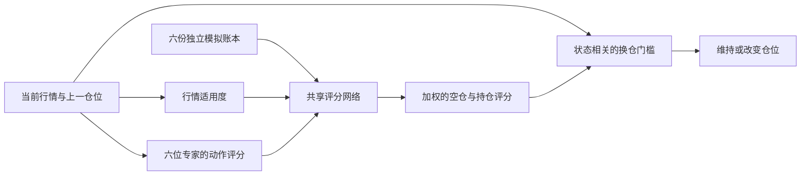

# ETH Expert Routing

ETH Expert Routing 研究一个分钟级交易决策：**多个专家意见不一致时，应该听谁，以及当前的切换优势是否足以改变仓位？** 策略在 ETHUSDT 的空仓与固定规模持仓之间选择。底层有六个冻结专家，强化学习控制器负责聚合意见和决定换仓。

## 两步决策



**先判断该听谁。** 每个专家都对空仓和持仓打分。共享评分网络结合专家身份、当前建议、近期扣费表现、换仓频率和行情适用度，给六个专家动态分配权重，再用这些权重聚合两个动作的评分。

**再判断该不该动。** 决策层根据当前市场、上一仓位、专家分歧和适用度输出一个非负门槛。只有切换仓位的评分优势超过门槛，策略才改变仓位。门槛以动作价值为单位，由高层训练学习。模拟账户依据实际成交结算手续费。

## 专家证据怎样产生

- **近期实绩来自独立账本。** 每个专家根据自己的上一仓位沿一条独立路径决策。路由器读取截至当前已结算的滚动净损益与换仓频率。这样可以观察各专家实际会承担的交易费用。
- **行情适用度来自它擅长的市场片段。** 用训练期已结算的一小时片段识别各专家相对占优的环境，再根据过去一小时的收益、波动、价差、成交量和订单失衡计算相似程度。首版使用历史中心距离，并实现了 VAE 重构误差作为可选的适用度估计。时间向前构建特征，首次拟合和标定只使用当时已有的记录。
- **回放逐分钟记录动作依据。** 选中一分钟，可以查看六位专家的建议、适用度和权重，以及聚合建议是否通过换仓门槛。回放以决策轨迹作为输入。

## 研究问题与实验结论

1. **看见专家投票是否足够？** 在相同的验证区间和训练预算下，加投票改变了持仓时点，回撤较小，扣费净收益也较低。投票本身在这轮没有带来净收益改善。
2. **结合近期实绩与行情适用度，能否形成更好的交易决策？** 完整架构在单种子验证期取得四组中最高的扣费净收益，高于市场条件路由基线及跟随近期最佳专家的规则。与基线相比，它持仓更久、换仓更多、最大回撤更大，净收益优势主要来自一个月。因此结果支持这段验证期的整体收益改善，跨市场时段的稳定性尚待验证。
3. **动态门槛是否改变交易？** 完整架构在实际回放路径上建议换仓 66 次，最终执行了 66 次。此轮回放中，门槛没有改变动作。现有结果无法把收益改善归因于门槛。

这轮实验使用同一时间切分和单个随机种子，结果来自验证集。留出的测试集尚未评估。

## 代码结构与运行

项目按决策流程组织。[`market`](eth_router/market.py) 准备分钟行情，[`evidence`](eth_router/evidence.py) 维护专家账本并拟合适用度，[`policy`](eth_router/policy.py) 实现专家评分和换仓门槛，[`train`](eth_router/train.py) 提供独立的 Double DQN 训练入口，[`replay`](eth_router/replay.py) 和 [`viewer`](eth_router/viewer.py) 生成逐分钟决策记录及交互页面。

准备 Python 3.11+、单独取得的专家源仓库以及 `df_train.feather`、`df_val.feather`。下面的 `LOCAL_EXPERT_CHECKOUT` 是本地依赖路径。可将训练命令的 `--score-device cpu` 改成 `cuda:0`，用 GPU 批量生成专家评分。

```bash
python -m pip install -r requirements.txt
python -m eth_router.market --source data/raw --output data/market
python -m eth_router.evidence --upstream LOCAL_EXPERT_CHECKOUT --source data/market --output data/evidence
python -m eth_router.train --upstream LOCAL_EXPERT_CHECKOUT --data data/evidence --output runs/router --score-device cpu
python -m eth_router.viewer --trace runs/router/expert_trace.npz --output runs/router/replay.html
```

上面的实验结论来自项目完成时的正式训练对照，使用了示范与记忆辅助损失。发布版采用独立的 Double DQN 训练入口，保留同一个决策网络和回放口径。该入口已做短程验证。使用原实验的高层检查点回放时，发布版在完整验证区间复现了原来的仓位路径和净损益。

## 研究来源

此仓库提供路由、专家证据构建、训练和回放实现。实验使用 MacroHFT 的历史市场数据和六个冻结专家，适用度设计参考 FineFT。上游代码、市场数据与权重请从作者提供的来源单独取得。专家适配器按 MacroHFT 提交 `31e5ef41f93b2aea6e63e6ae2267675c997a8e54` 的接口验证。[MacroHFT · KDD 2024](https://github.com/ZONG0004/MacroHFT/tree/31e5ef41f93b2aea6e63e6ae2267675c997a8e54) · [FineFT · KDD 2026](https://github.com/qinmoelei/FineFT_code_space)
