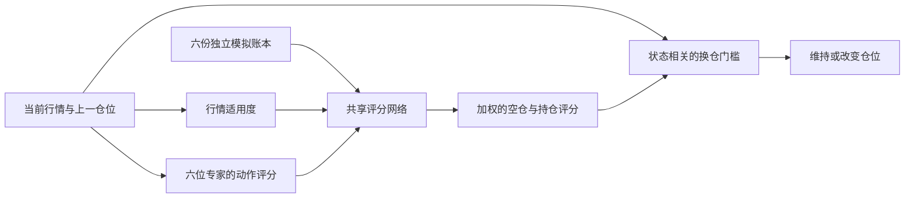

# ETH Expert Routing

ETH Expert Routing 研究一个分钟级交易决策：**多个专家意见不一致时，应该听谁，以及当前的切换优势是否足以改变仓位？** 策略在 ETHUSDT 的空仓与固定规模持仓之间选择。底层有六个冻结专家，强化学习控制器负责聚合意见和决定换仓。

## 两步决策



**先判断该听谁。** 每个专家都对空仓和持仓打分。共享评分网络结合专家身份、当前建议、近期扣费表现、换仓频率和行情适用度，给六个专家动态分配权重，再用这些权重聚合两个动作的评分。

**再判断该不该动。** 决策层根据当前市场、上一仓位、专家分歧和适用度输出一个非负门槛。只有切换仓位的评分优势超过门槛，策略才改变仓位。门槛以动作价值为单位，由高层训练学习。模拟账户依据实际成交结算手续费。

## 专家证据怎样产生

- **近期实绩来自独立账本。** 每个专家根据自己的上一仓位沿一条独立路径决策。路由器读取截至当前已结算的滚动净损益与换仓频率。这样可以观察各专家实际会承担的交易费用。
- **行情适用度来自它擅长的市场片段。** 用训练期已结算的一小时片段识别各专家相对占优的环境，再根据过去一小时的收益、波动、价差、成交量和订单失衡计算相似程度。首版使用历史中心距离，并实现了 VAE 重构误差作为可选的适用度估计。时间向前构建特征，首次拟合和标定只使用当时已有的记录。
- **回放逐分钟记录动作依据。** 选中一分钟，可以查看六位专家的建议、适用度和权重，以及聚合建议是否通过换仓门槛。回放以决策轨迹作为输入。

## 研究问题与实验结论

1. **看见专家投票是否足够？** 在相同的验证区间和训练预算下，加投票改变了持仓时点，回撤较小，扣费净收益也较低。投票本身在这轮没有带来净收益改善。
2. **结合近期实绩与行情适用度，能否形成更好的交易决策？** 完整架构在单种子验证期取得四组中最高的扣费净收益，高于市场条件路由基线及跟随近期最佳专家的规则。与基线相比，它持仓更久、换仓更多、最大回撤更大，净收益优势主要来自一个月。因此结果支持这段验证期的整体收益改善，跨市场时段的稳定性尚待验证。
3. **动态门槛是否改变交易？** 完整架构在实际回放路径上建议换仓 66 次，最终执行了 66 次。此轮回放中，门槛没有改变动作。现有结果无法把收益改善归因于门槛。

这轮实验使用同一时间切分和单个随机种子，结果来自验证集。留出的测试集尚未评估。

## 强化学习 Agent 怎样训练

专家负责给出动作价值，高层 Agent 负责选择实际仓位并接收扣费后的奖励。每分钟的交易转移进入经验回放。在线网络从这些转移中学习未来净损益，目标网络提供相对稳定的下一步估值。训练还会检索相似状态下采取同一动作的近期经验，并利用仅由训练价格生成的动态规划示范约束动作分布。三个目标共同更新专家权重和换仓门槛。

- [专家模型与冻结权重加载](eth_router/experts.py) 定义底层网络。本项目直接读取权重和特征名。
- [市场环境](eth_router/market_env.py) 实现仓位转移、模拟成交、费用及训练专用的动态规划示范。
- [Agent 更新](eth_router/agent.py) 实现探索、Double DQN、目标网络软更新及三项损失。[经验存储](eth_router/memory.py) 分别负责随机回放与相似状态价值检索。
- [完整架构说明](docs/architecture.md) 展开逐分钟闭环、模型输入和每项训练信号。

## 运行

准备 Python 3.11+、作者提供的专家权重和特征列表，以及原始 `df_train.feather` 和 `df_val.feather`。将 `single_features.npy`、`trend_features.npy` 与六个权重文件放入 `data/experts`。六个权重对应作者的 slope 1–3 和 vol 1–3，依次命名为 `slope_1.pkl` 至 `slope_3.pkl`、`vol_1.pkl` 至 `vol_3.pkl`。也可用 `--upstream LOCAL_EXPERT_CHECKOUT` 读取这些文件的原始路径。

```bash
python -m pip install -r requirements.txt
python -m eth_router.market --source data/raw --output data/market
python -m eth_router.evidence --expert-assets data/experts --source data/market --output data/evidence
python -m eth_router.train --expert-assets data/experts --data data/evidence --output runs/router
python -m eth_router.viewer --trace runs/router/expert_trace.npz --output runs/router/replay.html
```

训练输出包含各损失、情景记忆命中数、检查点与决策轨迹。已有高层检查点可以交给 [回放入口](eth_router/replay.py)。发布版的训练链路通过了短程检查。加载已完成正式实验的高层检查点时，发布版完整重放了验证期的 172,439 个动作，净损益一致。README 中的实验结论来自原正式对照。

## 研究来源

实验使用 MacroHFT 的历史数据与六个冻结专家权重。情景记忆及示范辅助优化来自该论文方法，适用度设计参考 FineFT。仓库内包含可读的专家网络与 Agent 训练实现。历史数据、特征列表和底层权重可从作者来源单独取得，其序列化格式按 MacroHFT 提交 `31e5ef41f93b2aea6e63e6ae2267675c997a8e54` 验证。[MacroHFT · KDD 2024](https://github.com/ZONG0004/MacroHFT/tree/31e5ef41f93b2aea6e63e6ae2267675c997a8e54) · [FineFT · KDD 2026](https://github.com/qinmoelei/FineFT_code_space)
