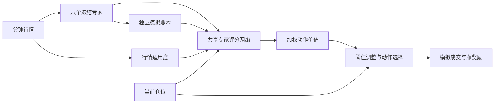

# ETH Expert Routing

**面向 ETHUSDT 分钟级交易的多专家强化学习系统。**

本项目研究交易成本约束下的专家路由与仓位控制。六个冻结专家分别估计空仓和持仓的动作价值。高层策略利用各专家的近期扣费表现与当前行情适用度，动态聚合动作价值，再根据状态相关的换仓阈值确定目标仓位。仓库提供数据处理、训练、验证回放和逐分钟决策查看工具。

## Quick Start

以下步骤使用缩短的训练与验证区间检查完整流程。需要 Python 3.11+、Git，以及作者提供的分钟行情、特征列表和专家权重。命令从项目根目录执行，默认使用 CPU。

### 1. 安装依赖

```bash
python -m venv .venv
```

激活环境。macOS 或 Linux 使用 `source .venv/bin/activate`，Windows PowerShell 使用 `.\.venv\Scripts\Activate.ps1`。

```bash
python -m pip install -r requirements.txt
```

### 2. 准备行情与专家权重

从作者公开的数据目录下载 `df_train.feather` 和 `df_val.feather`，保存至 `data/raw/`。以下命令取得与实验对应的特征列表及六个冻结专家权重。[ETHUSDT 数据目录](https://drive.google.com/drive/folders/1AYHy-wUV0IwPoA7E1zvMRPL3wK0tPNiY)

```bash
git clone https://github.com/ZONG0004/MacroHFT.git data/expert-source
git -C data/expert-source checkout 31e5ef41f93b2aea6e63e6ae2267675c997a8e54
```

`--upstream` 只读取特征列表及权重。若已将它们整理到独立目录，也可使用 `--expert-assets`。文件命名见[运行配置](docs/architecture.md#运行配置)。

### 3. 训练并生成回放

```bash
python -m eth_router.market --source data/raw --output runs/quickstart/market --limit 8192
python -m eth_router.evidence --upstream data/expert-source --source runs/quickstart/market --output runs/quickstart/evidence --fold-minutes 3600 --epochs 1
python -m eth_router.train --upstream data/expert-source --data runs/quickstart/evidence --output runs/quickstart/model
python -m eth_router.viewer --trace runs/quickstart/model/expert_trace.npz --output runs/quickstart/replay.html
```

训练结束后，`runs/quickstart/model/` 包含路由策略检查点 `router.pt` 和验证轨迹 `expert_trace.npz`。打开 `runs/quickstart/replay.html` 可查看每分钟的专家意见、路由权重、换仓阈值、仓位和交易费用。完整数据训练、CUDA 选项及检查点回放命令见[运行配置](docs/architecture.md#运行配置)。

## 系统架构



**专家证据。** 每位专家按自身仓位路径维护独立模拟账本，提供过去 360 分钟已结算的净损益、换仓频率及有效历史长度。行情适用度根据最近 60 分钟的收益、波动率、价差、成交量和订单失衡，估计当前市场与该专家历史优势片段的相似程度。默认采用历史中心距离，也可使用变分自编码器的重构误差。

**专家路由。** 共享评分网络接收专家身份、动作偏好、账本统计、行情适用度及共享市场状态，并输出归一化权重。空仓与持仓的聚合价值为六个专家对应动作价值的加权和。

**仓位控制。** 阈值网络根据市场状态、当前仓位、专家分歧及加权适用度生成非负阈值。该阈值以动作价值为单位，从换仓动作的聚合价值中扣减。策略依据调整后的价值选择目标仓位，交易环境在模拟成交时结算手续费。

**强化学习。** 高层 Agent 从逐分钟转移中学习。Double DQN 的时序差分目标、情景记忆的相似状态价值目标及动态规划示范的 KL 损失共同更新路由网络与换仓阈值。底层专家参数冻结，示范仅由训练行情生成。[架构与训练细节](docs/architecture.md)

## 实验结论

在固定数据切分和单个随机种子的验证实验中，完整架构取得最高的扣费净损益，同时持仓比例、换仓次数和最大回撤均高于市场条件路由基线。净损益优势主要集中在一个月。仅加入专家投票的版本改变了持仓路径，回撤下降，扣费净损益也有所下降。

完整架构在记录的验证路径上提出并执行了 66 次换仓。阈值调整在该路径上未改变动作，因此本次实验无法将净损益改善归因于换仓阈值。已有结论限于该验证区间，保留测试集尚未评估。

发布实现通过了短程训练检查。加载正式实验的高层检查点后，仓库中的回放程序复现了完整验证期的 172,439 个动作及净损益。上述比较结论来自原正式训练对照。

## 代码索引

- **市场数据与证据** · [行情预处理](eth_router/market.py) · [专家账本与适用度](eth_router/evidence.py)
- **专家与策略** · [专家网络](eth_router/experts.py) · [路由与阈值](eth_router/policy.py)
- **环境与优化** · [交易环境与示范](eth_router/market_env.py) · [Agent 更新](eth_router/agent.py) · [经验与情景记忆](eth_router/memory.py)
- **执行入口** · [训练](eth_router/train.py) · [验证回放](eth_router/replay.py) · [回放页面生成](eth_router/viewer.py)

## 研究来源

实验使用 MacroHFT 发布的历史数据及六个预训练专家。示范辅助优化与情景记忆沿用其方法，行情适用度建模参考 FineFT。专家证据、共享评分网络与换仓阈值构成本项目的策略扩展。[MacroHFT · KDD 2024](https://doi.org/10.1145/3637528.3672064) · [FineFT · KDD 2026](https://github.com/qinmoelei/FineFT_code_space)
