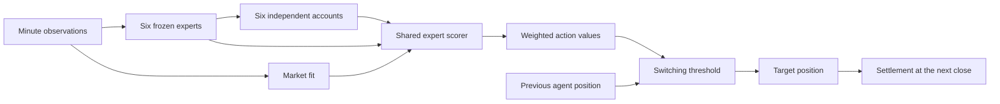

# ETH Expert Routing

ETH Expert Routing is a PyTorch agent that manages a simulated ETH/USDT position one minute at a time. Six frozen trend and volatility specialists each score two positions: flat and long 0.2 ETH. The agent learns how much weight to give each specialist and how large an advantage it needs to switch positions. Every decision can be inspected in a browser replay.

## Features

- **Independent expert accounts** — Follow the trades each specialist would have made on its own. Its six-hour performance record includes fees and tracks how often it changed position, even when the agent followed another specialist.
- **Walk-forward market fit** — Compare the current hour with historical conditions in which each specialist outperformed the group median. Fit scores for training are generated from previously settled windows. Validation uses models fitted on the training split.
- **Position-aware routing** — Ask every specialist to score both actions from the agent's actual position. A shared network can give different weights to two experts recommending the same trade based on the strength of their preferences, their track records and their fit to current conditions.
- **Minute-level decision replay** — Select a timestamp to inspect the votes and weights, compare action values before and after the switching threshold, and see the position and fee recorded by the simulator.

## Architecture



### Expert routing

The router uses two views of each specialist. Its track record follows its own sequence of positions. Its current recommendation answers a different question: given the position the agent actually holds, how does this expert value staying flat or holding ETH? Keeping these paths separate means the router can evaluate a specialist that has held ETH for an hour even if the agent is still flat.

The shared scorer reads each expert's identity, preferred direction and action-value margin alongside settled performance and market fit. Fit is calibrated using one-hour return, volatility, spread, volume and volume imbalance. The default estimator measures standardized distance from the center of favorable windows. An optional estimator uses variational autoencoder reconstruction error. A softmax turns the six expert scores into weights, and the same weights aggregate the flat and long action values.

### Position control

A second network sets a switching threshold from the market state, previous position, expert disagreement and weighted market fit. For example, when the agent is flat, the threshold is subtracted from the aggregated long value before the policy selects the higher-valued action. The threshold is expressed in action-value units. The simulator separately charges 0.02% of traded value when a position changes at the current close and marks the position at the next close.

### Policy training

For each training minute, the simulator can settle both possible actions against the same next close. From a flat account these actions mean staying flat or buying. From a long account they mean selling or holding. The default trainer evaluates all four cases, charging each switch its own fee. This pairing relies on the simulator's fixed price path and assumes the agent's orders have no market impact.

A Double DQN target adds the continuation value from the position each action would leave behind. Two Huber losses train the shared scorer and threshold together. One fits the action values, and the other fits the difference between them, giving the decision margin a direct training signal. The next price enters the target only after the simulated step. During replay the agent sees the current observations and its actual position.

## Quick Start

Run the following commands from the repository root with Python 3.11 or newer and Git. This example uses shortened data splits and runs on a CPU.

### Install dependencies

```bash
python -m venv .venv
```

Activate the environment with `source .venv/bin/activate` on macOS or Linux, or `.\.venv\Scripts\Activate.ps1` in Windows PowerShell.

```bash
python -m pip install -r requirements.txt
```

### Prepare data and expert weights

Download `df_train.feather` and `df_val.feather` into `data/raw/` from the dataset released with MacroHFT. [ETH/USDT dataset](https://drive.google.com/drive/folders/1AYHy-wUV0IwPoA7E1zvMRPL3wK0tPNiY)

The pinned checkout below supplies the feature lists and six pretrained weights. The `--upstream` option reads those files. Agent training and inference run through this repository's implementation.

```bash
git clone https://github.com/ZONG0004/MacroHFT.git data/expert-source
git -C data/expert-source checkout 31e5ef41f93b2aea6e63e6ae2267675c997a8e54
```

### Train and replay

```bash
python -m eth_router.market --source data/raw --output runs/quickstart/market --limit 8192
python -m eth_router.evidence --upstream data/expert-source --source runs/quickstart/market --output runs/quickstart/evidence --fold-minutes 3600 --epochs 1
python -m eth_router.train --upstream data/expert-source --data runs/quickstart/evidence --output runs/quickstart/model
python -m eth_router.viewer --trace runs/quickstart/model/expert_trace.npz --output runs/quickstart/replay.html
```

Training saves the router checkpoint as `runs/quickstart/model/router.pt` and the validation trace alongside it. Open `runs/quickstart/replay.html` in a browser to inspect each minute's expert recommendations, routing weights, switching threshold, selected position, and transaction fee.

For full-length data splits, omit `--limit 8192` from the market preparation command and `--fold-minutes 3600 --epochs 1` from the evidence command. Additional options cover CUDA expert inference, independently stored weights, and replay from an existing checkpoint. [Architecture and configuration](docs/architecture.md)

Data, checkpoint and method credits are listed in the [architecture notes](docs/architecture.md#sources).
