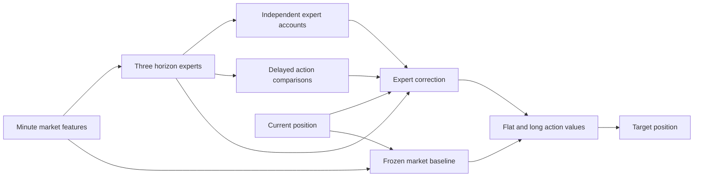

# ETH Expert Routing

**Learning from Counterfactual Trade Outcomes**

ETH Expert Routing is a PyTorch agent that manages a simulated ETH/USDT position one minute at a time. Three specialists assess whether to stay flat or hold 0.2 ETH. A position policy combines their current recommendations with records of how their earlier recommendations settled.

## Architecture



### Expert training

The three specialists start with the same architecture and initialization. They use causal return, volatility, volume, spread and order-imbalance features. Their reward discounts have half-lives of 5, 30 and 120 minutes, so they learn action values over different time scales while making decisions every minute. The training split is divided chronologically. Experts train on the first 60% and stay frozen while the position policy learns on the remaining 40%.

### Expert evidence

Each expert trades in an independent simulated account. Its recent net PnL and turnover describe how following that expert would have played out. A second record evaluates its individual recommendations from each possible starting position. The simulator marks both candidate positions at 5, 30 and 120 minutes after the simulated fill and charges the corresponding initial fee. Each expert is evaluated at all three windows so the policy can compare them on equal terms. The rolling record tracks net advantage, win rate with half credit for ties, and settled sample count.

### Position policy

The controller adds an expert-based correction to a frozen market-only Q network. A shared encoder reads each expert's log half-life, current recommendation, normalized action-value gap and settled records. The correction uses the mean of these encodings and the current position. The replay records how often it changes the market baseline's action at the same position.

A decision uses the completed observations available through bar `t`, then fills at the close of bar `t+1`. Returns and fees enter the learning objective in basis points relative to traded notional. The simulator charges 2 bp per switch and reports account PnL in USDT. Paired Double Q training fits the two action values and their difference using the four possible position transitions.

[Method and timing details](docs/method.md)

## Quick Start

Use Python 3.11 or newer. Create a virtual environment with `python -m venv .venv` and activate it with `source .venv/bin/activate` on macOS or Linux, or `.\.venv\Scripts\Activate.ps1` in PowerShell.

```bash
python -m pip install -r requirements.txt
```

Download `df_train.feather` and `df_val.feather` into `data/raw/`. Include `df_test.feather` for held-out replay. The minute data were released by the MacroHFT authors. [ETH/USDT dataset](https://drive.google.com/drive/folders/1AYHy-wUV0IwPoA7E1zvMRPL3wK0tPNiY)

```bash
python -m eth_router.horizons --source data/raw --output runs/quickstart --limit 24576 --expert-epochs 1 --policy-epochs 1
python -m eth_router.viewer --trace runs/quickstart/full_val.npz --output runs/quickstart/replay.html
```

Open the HTML replay to inspect expert recommendations, settled evidence, action values and simulated fees. For full training, omit the row limit and the epoch overrides. Add `--device cuda:0` with a CUDA build of PyTorch. The run saves the trained experts, checkpoints and validation traces for the market-only baseline, full expert policy and ledger-only control. Adding `--test` evaluates their validation-selected checkpoints on the test split.

## Experiments

- [Forecast-driven position rule and its historical replay](docs/rule-replay.md)
- [Shared-signal policy comparison](docs/signal-study.md)
- [Fixed-entry exit study](docs/exit-study.md)
- [Contextual holding-period study](docs/duration-study.md)

The previous six-expert workflow and its checkpoint sources are documented in the [legacy architecture notes](docs/legacy/six-expert-architecture.md).
