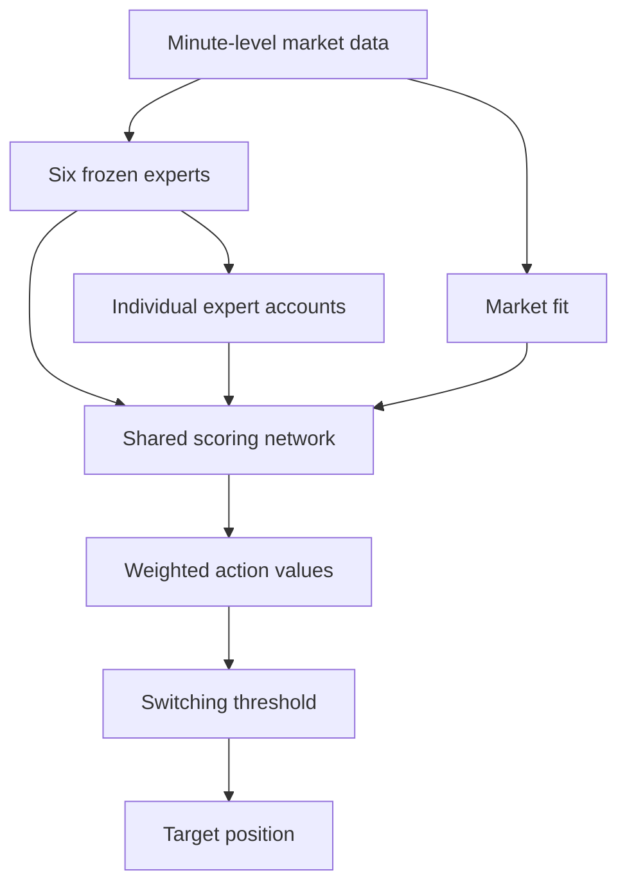

# ETH Expert Routing

ETH Expert Routing is a reinforcement learning project for minute-level ETH/USDT position management. It studies how a policy can combine specialist trading signals as market conditions change and decide whether a proposed position change justifies another trade.

The system separates expert weighting from position control. An expert's current recommendation, recent performance after fees, and fit to the present market all inform its weight. A learned switching threshold then determines how much support a change in position needs. The repository includes the training pipeline and an interactive replay that records the evidence behind each decision.

## Architecture



### Expert evidence

Recent performance and market fit describe different aspects of an expert's behavior. Each expert trades in its own simulated account, which provides a rolling record of settled net profit and loss and position changes. Market fit describes how closely current conditions resemble historical windows in which that expert performed well relative to its peers.

FineFT models the market conditions in which an expert tends to perform well and uses this information to guide routing. ETH Expert Routing adapts that idea by supplying a market-fit score to the learned weighting network alongside recent performance. The default score uses distance from an expert's historical feature center. A variational autoencoder provides an optional reconstruction-based score. [FineFT, KDD 2026](https://doi.org/10.1145/3770854.3780187)

### Expert routing

MacroHFT provides the hierarchical starting point and six pretrained specialists covering trend and volatility conditions. Each specialist estimates the value of holding ETH and staying flat. A shared network scores each expert using its identity, action preferences, and evidence in the current market. The resulting weights sum to one and are applied to both action values, so the policy can draw on several experts at once. [MacroHFT, KDD 2024](https://doi.org/10.1145/3637528.3672064)

### Position control

The router may favor a different position by a small margin. Before selecting an action, the policy lowers the value of switching by a learned, nonnegative threshold. The threshold depends on the market state, the current position, expert disagreement, and the fit of the experts receiving weight. The simulator charges a fee on each executed position change.

### Policy training

The high-level policy learns from the net reward of each simulated transition while the experts remain frozen. Double DQN supplies the temporal-difference target. Two auxiliary objectives adapted from MacroHFT provide additional training signals. Episodic memory retrieves value estimates from nearby observations with the same action, and dynamic programming over the training price series supplies demonstration targets for the action distribution. The shared router and switching threshold are optimized together. [MacroHFT, KDD 2024](https://doi.org/10.1145/3637528.3672064)

## Quick Start

Run the following commands from the repository root with Python 3.11 or newer and Git. This example uses shortened data splits and runs on a CPU.

### Install dependencies

```bash
python -m venv .venv
```

Activate the environment with `source .venv/bin/activate` on macOS or Linux, or `.\.venv\Scripts\Activate.ps1` in Windows PowerShell.

```bash
python -m pip install -r requirements.txt
```

### Prepare data and expert weights

Download `df_train.feather` and `df_val.feather` into `data/raw/` from the dataset released with MacroHFT. [ETH/USDT dataset](https://drive.google.com/drive/folders/1AYHy-wUV0IwPoA7E1zvMRPL3wK0tPNiY)

The pinned checkout below supplies the feature lists and six pretrained weights. The `--upstream` option reads those files. Agent training and inference run through this repository's implementation.

```bash
git clone https://github.com/ZONG0004/MacroHFT.git data/expert-source
git -C data/expert-source checkout 31e5ef41f93b2aea6e63e6ae2267675c997a8e54
```

### Train and replay

```bash
python -m eth_router.market --source data/raw --output runs/quickstart/market --limit 8192
python -m eth_router.evidence --upstream data/expert-source --source runs/quickstart/market --output runs/quickstart/evidence --fold-minutes 3600 --epochs 1
python -m eth_router.train --upstream data/expert-source --data runs/quickstart/evidence --output runs/quickstart/model
python -m eth_router.viewer --trace runs/quickstart/model/expert_trace.npz --output runs/quickstart/replay.html
```

Training saves the router checkpoint as `runs/quickstart/model/router.pt` and the validation trace alongside it. Open `runs/quickstart/replay.html` in a browser to inspect each minute's expert recommendations, routing weights, switching threshold, selected position, and transaction fee.

For full-length data splits, omit `--limit 8192` from the market preparation command and `--fold-minutes 3600 --epochs 1` from the evidence command. Additional options cover CUDA expert inference, independently stored weights, and replay from an existing checkpoint. [Architecture and configuration](docs/architecture.md)
