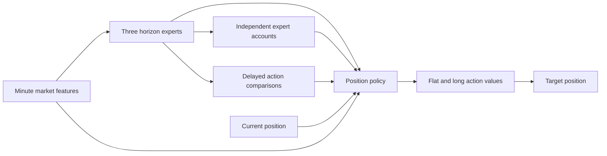

# ETH Expert Routing

**Learning from Counterfactual Trade Outcomes**

ETH Expert Routing is a PyTorch agent that manages a simulated ETH/USDT position one minute at a time. Three specialists assess whether to stay flat or hold 0.2 ETH. A position policy combines their current recommendations with records of how their earlier recommendations settled.

## Architecture



### Expert training

The three specialists start with the same architecture and initialization. They use causal return, volatility, volume, spread and order-imbalance features. Their reward discounts have half-lives of 5, 30 and 120 minutes, so they learn action values over different time scales while making decisions every minute. The training split is divided chronologically. Experts train on the first 60% and stay frozen while the position policy learns on the remaining 40%.

### Expert evidence

Each expert trades in an independent simulated account. Its recent net PnL and turnover describe how following that expert would have played out. A second record evaluates its individual recommendations from each possible starting position. For each recommendation, the simulator marks both candidate positions 30 minutes later and charges the corresponding initial trade fee. The rolling record tracks the recommended action's net advantage, win rate with half credit for ties, and sample count. A result becomes available when its window closes.

### Position policy

The controller reads the expert's recommendation from its actual starting position alongside the expert's normalized action-value gap and settled records. A shared encoder processes the three inputs, and their mean feeds a Q network together with the market features and current position. The network estimates the two action values and selects the higher one. Training fits both action values and their difference using Double Q targets for all four position transitions on the same price move. The simulator assumes a fixed market path and charges 0.02% of traded value at the current close.

## Quick Start

Use Python 3.11 or newer. Create a virtual environment with `python -m venv .venv` and activate it with `source .venv/bin/activate` on macOS or Linux, or `.\.venv\Scripts\Activate.ps1` in PowerShell.

```bash
python -m pip install -r requirements.txt
```

Download `df_train.feather` and `df_val.feather` into `data/raw/`. Include `df_test.feather` for held-out replay. The minute data were released by the MacroHFT authors. [ETH/USDT dataset](https://drive.google.com/drive/folders/1AYHy-wUV0IwPoA7E1zvMRPL3wK0tPNiY)

```bash
python -m eth_router.horizons --source data/raw --output runs/quickstart --limit 24576 --expert-epochs 1 --policy-epochs 1
python -m eth_router.viewer --trace runs/quickstart/full_val.npz --output runs/quickstart/replay.html
```

Open the HTML replay to inspect expert recommendations, settled evidence, action values and simulated fees. For full training, omit the row limit and the epoch overrides. Add `--device cuda:0` with a CUDA build of PyTorch. The run saves the trained experts, checkpoints and validation traces for both the full policy and the ledger-only control. Adding `--test` evaluates the two validation-selected checkpoints on the test split.

The previous six-expert workflow and its checkpoint sources are documented in the [legacy architecture notes](docs/architecture.md).
