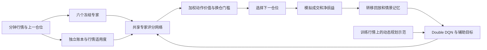

# Agent 架构与训练

系统模拟 ETHUSDT 的分钟级持仓决策。每个动作代表目标仓位，空仓为 0，持仓为 0.2 ETH。本文说明一次交互如何产生训练数据，以及各训练目标怎样更新策略。

## 从市场观测到仓位

1. [专家网络](../eth_router/experts.py) 分别对空仓和持仓评分。即时行情经归一化后，由趋势特征和上一仓位调制。价值分支和动作优势分支共同产生 Q 值，各样本的优势分别中心化。六个模型的参数在整段训练中保持冻结。[权重加载器](../eth_router/checkpoint_source.py) 将外部权重字段映射到本项目的网络，训练和回放均可从只有权重与特征名的数据目录启动。
2. [专家证据](../eth_router/evidence.py) 包含 360 分钟内已结算的净损益、换仓频率、有效历史长度及行情适用度。每位专家的账户按自己的持仓路径滚动，主账户的持仓只决定主策略本步应该向专家查询哪组动作评分。适用度由向前切分拟合，验证使用冻结标定。
3. [策略网络](../eth_router/policy.py) 用共享 MLP 计算六个专家的 logits，并用 softmax 得到权重。每个专家的输入包括身份、当前建议与分差、专家证据，以及共享的市场状态和上一仓位。加权后，策略只对会改变仓位的动作扣减动态门槛，最终动作由调整后的 Q 值决定。
4. [交易环境](../eth_router/market_env.py) 在第 t 分钟收盘价模拟成交，按成交金额计费，用第 t+1 分钟收盘价结算持仓损益。训练程序顺序推进分钟及仓位，回放预先批量计算两种上一仓位的决策，再沿实际动作路径结算。

## 三种信号怎样训练高层

[训练入口](../eth_router/train.py) 用 ε-greedy 执行探索。每次成交产生一个转移，记录时间索引、原仓位、动作、净奖励和终止标记。索引可以还原当时的行情与缓存的专家输出，训练时反复抽样同一批转移。

- **Double DQN 的时序差分损失。** 在线网络选择下一步动作，目标网络给该动作估值。终止时只使用当步净奖励。目标网络通过软更新跟随在线网络。
- **情景记忆损失。** [情景记忆](../eth_router/memory.py) 以策略的状态编码作为键，保存近期转移对应的一步估值。检索当前状态附近的经验后，对采取同一动作的记录按距离加权。记忆不足或无匹配动作时，用当前一步估值。随着编码器训练，定期重新编码记忆中的键。这个检索值和 TD 目标共同约束当前动作估值。
- **示范 KL 损失。** 从训练价格序列末尾向前做动态规划，计算不同起始仓位和动作的示范价值。训练时在相同状态上对齐策略与示范的动作分布。示范允许使用训练序列中后续的价格，只作为训练目标。它与回放中的在线观察、专家账本及适用度是分开的。

[Agent 更新代码](../eth_router/agent.py) 将三项合并为 **TD + 0.5 × 记忆损失 + 5 × 示范 KL**。每次更新只优化高层策略，动态门槛接入同一动作价值计算。实验环境费率为单边 0.02%，示范规划使用原实验的 0.10% 单边费率。运行时会打印三个损失、记忆命中数和键刷新次数，方便核查这些模块已参与优化。

## 实验与本仓库的关系

README 中的实验结论来自已完成的单种子验证对照。独立实现保留其三类训练目标、冻结专家和路由网络。使用原实验的高层检查点，独立实现可重放同一完整验证区间。独立训练入口做了短程集成检查，正式对照的具体数值以原实验记录为准。动态规划示范和带情景记忆的优化来自论文方法，行情适用度、专家证据、共享评分和换仓门槛是本项目的设计。[MacroHFT 论文](https://doi.org/10.1145/3637528.3672064)
