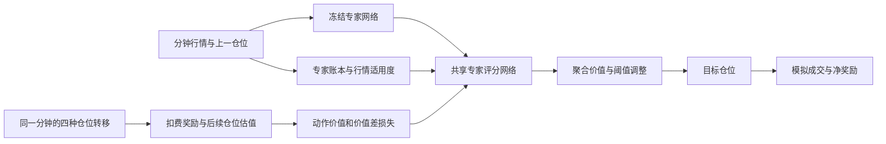

# 架构与训练

ETH Expert Routing 模拟 ETHUSDT 的分钟级仓位决策。动作空间由空仓和持有 0.2 ETH 两个目标仓位组成。高层策略聚合六个专家的动作价值，并对换仓动作施加状态相关的价值阈值。

## 观测与动作



1. **专家动作价值。** 即时行情经投影与归一化，趋势特征和上一仓位共同提供条件调制。每个专家的价值分支与动作优势分支构成 Dueling Q 网络，动作优势按观测分别中心化。六个专家参数在高层训练期间冻结。[专家网络](../eth_router/experts.py) · [权重加载](../eth_router/checkpoint_source.py)
2. **专家证据。** 六个模拟账户分别沿各专家的策略结算，构造截至当前时点的 360 分钟滚动净损益和换仓频率。高层实际仓位用于索引本步专家动作价值。行情适用度根据训练期优势片段估计，训练特征按时间向前拟合，验证使用从训练期得到的冻结模型和标定结果。[专家证据构建](../eth_router/evidence.py)
3. **专家路由与仓位控制。** 共享 MLP 对每个专家输出标量，经 softmax 得到专家权重。聚合价值为专家动作价值的加权和。阈值网络以市场状态、上一仓位、专家分歧及加权适用度为条件，对换仓动作的价值施加非负扣减。输出动作由两个调整后价值的最大值确定，价值相等时选择空仓。[路由策略](../eth_router/policy.py)
4. **模拟结算。** 在第 $t$ 分钟收盘价成交，按成交金额收取单边 0.02% 手续费。第 $t+1$ 分钟收盘价用于计算新仓位的标记损益，两者合成该步奖励。回放按两种上一仓位批量计算候选动作，再顺序恢复实际持仓路径。[交易环境](../eth_router/market_env.py) · [回放程序](../eth_router/replay.py)

## 配对动作训练

默认训练器在每个历史分钟枚举两种上一仓位和两种目标仓位，共用环境结算函数计算四种即时奖励。下一步按目标仓位索引后续价值，终止步的后续价值为零。每轮随机遍历训练分钟。两个等权 Huber 损失分别拟合动作价值与持仓相对空仓的价值差。

## 轨迹训练（命令行选项 `--trainer trajectory`）

训练使用 ε-greedy 探索。每个交易时点均产生一个转移，记录时间索引、上一仓位、动作、扣费奖励与终止标记。回放缓冲区保存这些转移，并支持随机批次采样。冻结的专家动作价值可批量预计算，高层策略随交互推进更新。[训练入口](../eth_router/train.py) · [经验存储](../eth_router/memory.py)

- **时序差分损失。** 在线网络选择后续动作，目标网络估计该动作价值。终止转移的目标仅包含当步净奖励。目标网络通过软更新跟随在线网络。
- **情景记忆损失。** 情景记忆以策略的状态编码为键，保存近期转移对应的一步估值。检索临近状态后，对采取相同动作的记录按距离加权。没有可用匹配时采用当前一步估值。随着编码器更新，存量键定期重新编码。
- **示范 KL 损失。** 在训练价格序列上执行向后的动态规划，计算各时点、各上一仓位和各动作的示范价值。训练用 KL 散度约束策略和示范的动作分布。示范规划沿用正式实验的单边 0.10% 费率。示范数据只进入辅助训练目标。

总损失为 $L=L_{\mathrm{TD}}+0.5L_{\mathrm{memory}}+5L_{\mathrm{demo}}$。优化参数为高层网络，专家权重与换仓阈值由同一动作价值损失更新。训练日志分别记录各损失、情景记忆命中数和键刷新次数。[Agent 更新](../eth_router/agent.py)

## 运行配置

`--expert-assets DIR` 接受以下目录结构。特征列表和权重应从可信来源取得。

```text
data/experts/
├── single_features.npy
├── trend_features.npy
├── slope_1.pkl
├── slope_2.pkl
├── slope_3.pkl
├── vol_1.pkl
├── vol_2.pkl
└── vol_3.pkl
```

使用完整切分时，在 [Quick Start](../README.md#quick-start) 的行情处理步骤移除 `--limit`，在专家证据步骤移除 `--fold-minutes 3600 --epochs 1`，并使用新的输出目录。默认以 43,200 分钟为首个适用度拟合区间，适用度模型每个拟合阶段训练 16 轮。路由策略的训练轮数由 `eth_router.train --epochs` 单独控制，默认一轮。

安装 CUDA 版 PyTorch 的环境可在专家证据构建时使用 `--device cuda:0`，在训练命令中用 `--score-device cuda:0` 批量计算专家输出。高层训练默认在 CPU 上运行。

已有高层检查点时，可单独生成验证回放。以下路径与 Quick Start 的输出对应。

```bash
python -m eth_router.replay --upstream data/expert-source --input runs/quickstart/evidence/val.feather --checkpoint runs/quickstart/model/router.pt --output runs/quickstart/validation.npz
python -m eth_router.viewer --trace runs/quickstart/validation.npz --output runs/quickstart/validation.html
```

## 实验记录

正式对照使用单个随机种子和固定验证区间。发布版保留三类训练目标、冻结专家与完整路由网络，训练入口已完成短程集成验证。用原正式实验检查点运行时，发布版复现了完整验证区间的动作序列和净损益。正式比较的数值仍以原实验记录为准。[MacroHFT 论文](https://doi.org/10.1145/3637528.3672064)

## Sources

[MacroHFT](https://github.com/ZONG0004/MacroHFT) supplies the market data, feature lists and pretrained specialists. The trajectory trainer adapts its hierarchical value aggregation, episodic memory and demonstration objectives. [FineFT](https://arxiv.org/abs/2512.23773) motivates estimating expert suitability from favorable market windows. Historical validation records above refer to the trajectory method.
